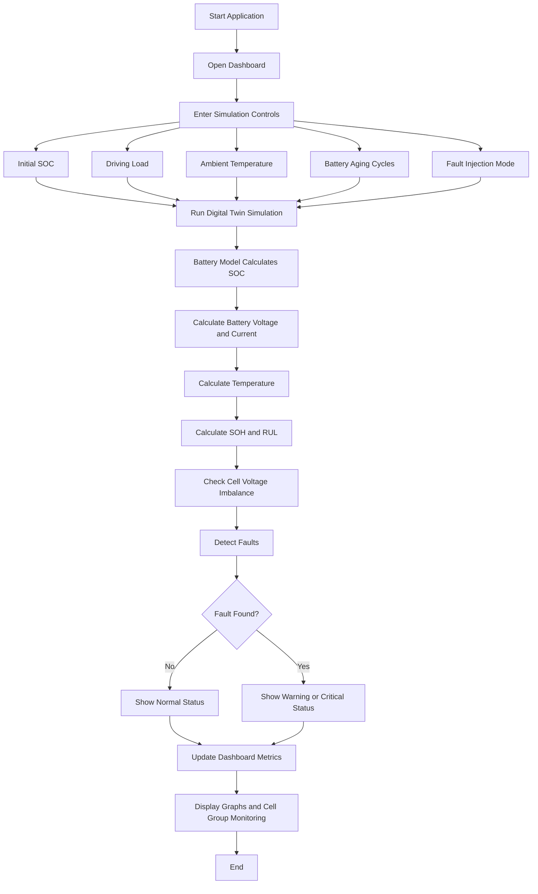

# EV Battery Pack Digital TwinEV Battery Digital Twin – Working Flowchart

Description

The EV Battery Digital Twin is a software model that simulates how an electric vehicle battery behaves during driving. The user enters values such as initial battery charge, driving load, outside temperature, battery aging cycles, and a fault condition.

When the user clicks Run Digital Twin Simulation, the system calculates the battery’s State of Charge (SOC), voltage, current, temperature, State of Health (SOH), and Remaining Useful Life (RUL). It also checks the voltage of all 12 battery groups to identify weak cells or cell imbalance.

If the system finds a problem such as high temperature, overcurrent, low battery health, or weak cell imbalance, it displays a warning or critical battery status. Finally, the dashboard updates the battery cards, fault details, battery pack image, and performance graphs.

Thank you.

A software-based Digital Twin of an Electric Vehicle lithium-ion battery pack.

## Features

- EV driving cycle simulation
- Battery SOC estimation
- Battery SOH estimation
- Equivalent Circuit Battery Model
- Thermal modelling
- Battery degradation modelling
- Remaining Useful Life prediction
- Cell-group imbalance detection
- BMS fault detection
- Streamlit dashboard

## Technologies

- Python
- NumPy
- Pandas
- Plotly
- Matplotlib
- Streamlit
- Scikit-learn

## Run the Project

Install dependencies:

```bash
pip install -r requirements.txt
